# App Flow: Client Meeting-to-Action Tracker

**Document version:** 0.1  
**Draft date:** 28 Oct 2026  
**Source documents:** `PRD-Client-Meeting-to-Action-Tracker.md` and `TRD-Client-Meeting-to-Action-Tracker.md`  
**Target release:** v1.0 — 8 Jan 2027  
**Status:** Draft for product and technical review

---

## 1. Purpose

This App Flow document describes how a user moves through the Client Meeting-to-Action Tracker, from entering a meeting transcript to reviewing extracted information and exporting approved outputs. It also describes the important system decisions, error paths, item states, and backend interactions.

The main user journey is:

**Create meeting → Add transcript or notes → Extract items → Review evidence and uncertainty → Resolve duplicates and gaps → Export approved results → Return to meeting history when needed.**

### Core flow rules

1. The user must be able to trace every extracted item to an evidence quote from the meeting text.
2. An owner or deadline that the transcript does not establish must remain `null` in structured data and display as **Not stated** in the UI and relevant exports.
3. Implied owners or deadlines must be distinguished from explicitly stated values.
4. Low-confidence items start as **Needs review** and must not be auto-accepted.
5. Every item must have a review decision before the export can complete.
6. Possible duplicates are flagged for human review. The application never deletes a duplicate automatically.
7. A failure during extraction must not lose the submitted transcript. Where possible, partial results are saved and the user receives a clear error or retry option.

## 2. Users and access

| User | Main activities | Access model in v1.0 |
|---|---|---|
| Project manager / account manager | Create meetings, review extracted items, clarify gaps, export trackers and minutes | Primary user |
| Team member / assignee | Use exported action lists and meeting minutes to understand assigned work | Consumes exported files; no separate in-app account in v1.0 |
| Team lead / reviewer | Review risks, open questions, duplicates, and historical items across a client | Uses the shared application access |
| Administrator | Configure provider/model, similarity threshold, date rules, and export mappings | Settings screen; protected by host-level shared password or company SSO |

Application-level user accounts and role-based permissions are not part of v1.0. The hosting environment controls access.

## 3. Application navigation

The application provides these main screens:

1. **New Meeting** — enter meeting details and supply text or upload a supported file.
2. **Review** — inspect and edit tasks, decisions, risks, and open questions, including their evidence and confidence.
3. **Clarify** — see items with missing or ambiguous information and copy suggested follow-up questions.
4. **Duplicates** — compare possible duplicate tasks and decide whether to keep, merge, or discard them.
5. **Export** — preview accepted information and download Excel, CSV, Word, or JSON output.
6. **History** — find past meetings and review open items by client.
7. **Settings** — configure the LLM provider/model, similarity threshold, date-resolution convention, and export column mappings.

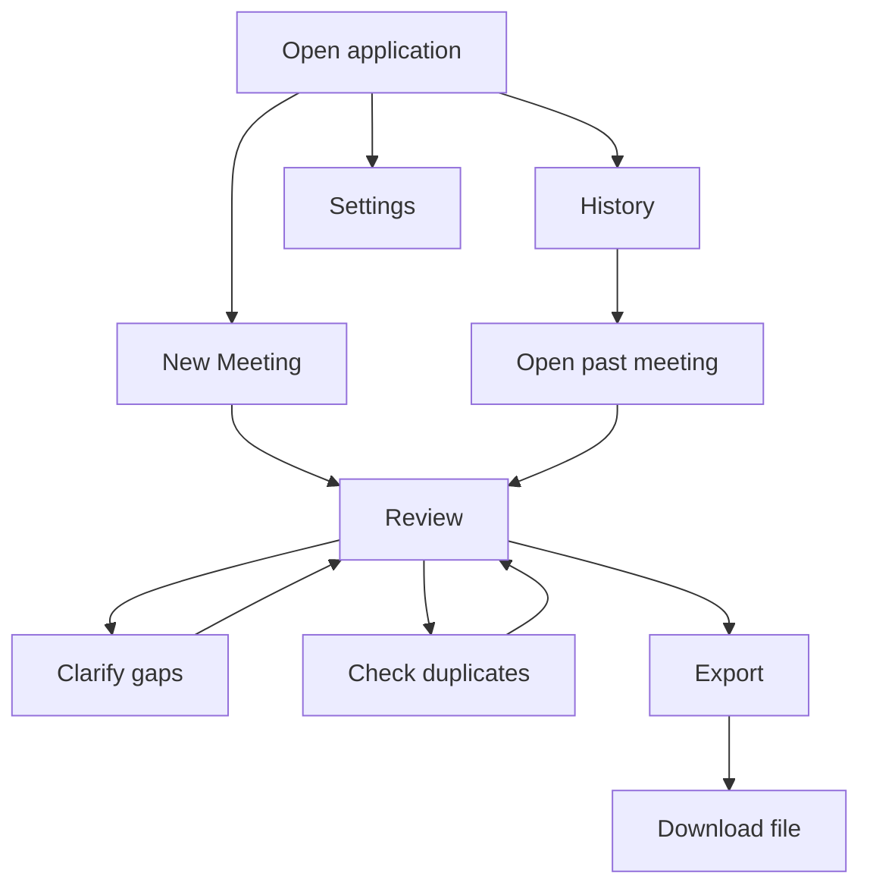

The user can navigate to History or Settings without beginning a new meeting. A past meeting can be opened from History for review or export using its saved data.

## 4. Main end-to-end user flow

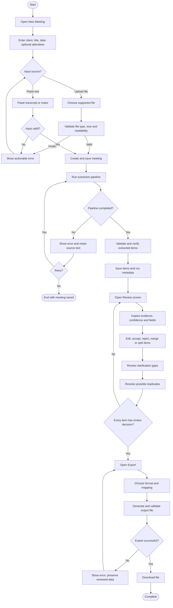

## 5. Flow 1 — Create a meeting and provide input

### 5.1 Screen entry

The user chooses **New Meeting** and fills in the meeting metadata:

- Client name — select an existing client or add a new one.
- Meeting title.
- Meeting date — optional according to the schema, but required to resolve relative dates into calendar dates.
- Attendees — optional list.
- Source — paste transcript/notes or upload a supported file.

Supported v1.0 file types are `.txt`, `.docx`, text-based `.pdf`, `.vtt`, and `.srt`, with a maximum upload size of 10 MB. Pasted text is limited to 150,000 characters. Scanned PDF OCR and audio transcription are out of scope.

### 5.2 Input validation

Before extraction, the application checks:

- Meeting text is not empty.
- Pasted text does not exceed the character limit.
- Uploaded file type is supported and the size is within the limit.
- File content can be read and converted to text.
- Required meeting metadata is present; optional metadata may remain empty.

If validation fails, the application shows a clear message beside the relevant field and allows the user to correct the input. It must not silently discard the source text.

### 5.3 Save and start extraction

After validation, the backend creates or identifies the client, stores the meeting and raw text in SQLite, and returns a meeting identifier. The UI shows extraction progress while the backend runs the pipeline.

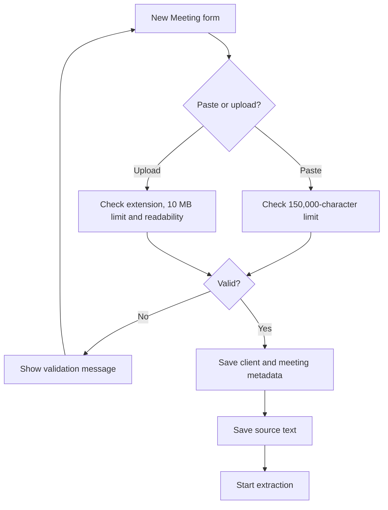

## 6. Flow 2 — Extract meeting information

The extraction process is automated after the user starts it. The user sees progress and receives either a reviewable result or a clear error.

### 6.1 Backend processing sequence

1. **Parse:** extract text from the input file or pasted text, normalize speaker labels, preserve speaker turns, and number lines for evidence references.
2. **Chunk:** divide long transcripts into chunks of approximately 6,000 tokens with 500 tokens of overlap, cutting at speaker turns where possible and not splitting mid-sentence.
3. **Extract:** send each chunk and the Pydantic-generated JSON Schema to the configured LLM provider. The model is instructed to return JSON only.
4. **Merge:** combine results from overlapping chunks and remove repeated items caused by overlap.
5. **Consolidate:** make a final pass to identify contradictions, such as a task cancelled later or a decision reversed during the meeting.
6. **Validate:** validate the result using Pydantic. If invalid, retry up to two times with the validation error included.
7. **Verify:** check evidence quote matches, owner references, and resolved dates using Python logic.
8. **Score and store:** calculate confidence, detect possible duplicates, save extracted items and run metadata, then return the result for review.

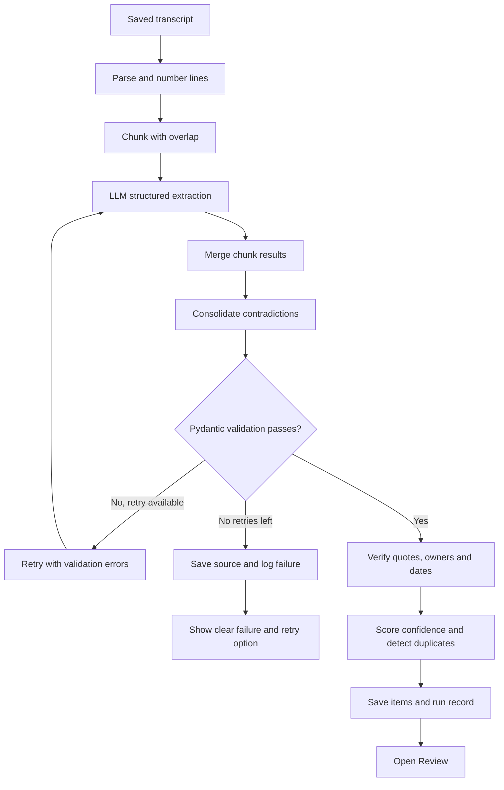

### 6.2 Extraction result categories

The result contains:

- **Tasks:** description, owner, due date, priority where stated, dependencies where stated, confidence, evidence, and clarification flags.
- **Decisions:** decision statement, decision-maker if supported, confidence, and evidence.
- **Risks:** description, impact and mitigation if available, owner state, confidence, and evidence.
- **Open questions:** question, who raised it if known, who it is directed to if supported, needed-by date if supported, confidence, and evidence.
- **Meeting summary:** client, title, date if known, attendees, and a concise summary.

Each extracted item has an identifier and one or more evidence references. Items without a sufficiently supported quote are flagged or treated as low confidence according to the verification rules.

### 6.3 Extraction error path

If the provider is unavailable, a call times out, or validation still fails after retries:

- Show a user-readable error instead of exposing a raw stack trace.
- Keep the saved transcript and meeting record.
- Store diagnostic metadata such as provider/model, prompt version, latency, and validation outcome.
- Do not log the transcript text.
- Offer the user a retry path. Partial results, if produced, must be saved without being presented as a fully verified successful extraction.

## 7. Flow 3 — Review and edit extracted items

The Review screen is the central workspace. It shows the transcript with line numbers on the left and item tabs on the right: **Tasks**, **Decisions**, **Risks**, and **Open questions**.

### 7.1 Information shown on each item

Depending on item type, the row or detail panel displays:

- Item description or statement.
- Owner or directed-to value and its state.
- Due date or needed-by date, including the raw wording when applicable.
- Priority or other fields only when supported by the transcript.
- Confidence: High, Medium, or Low.
- Review status.
- Evidence quote, speaker, and line reference when available.
- Clarification-needed flags.
- Human-edited indicator.
- Possible duplicate indicator, when applicable.

The UI must not rely on colour alone. Labels and text such as **Owner not stated**, **Date not stated**, and **Implied** accompany any colour cue.

### 7.2 Review actions

For every extracted item, the reviewer may:

- **Edit** fields inline. The system marks the item as human-edited and records the change in `review_events`.
- **Accept** the item.
- **Reject** the item.
- **Merge** items when they represent the same action or information.
- **Split** an item when it contains multiple separate actions or statements.
- Open the evidence reference to highlight the supporting text in the transcript where that interaction is available.

The reviewer should check the evidence and uncertainty flags before accepting an item. Low-confidence items remain in **Needs review** until explicitly reviewed.

### 7.3 Review state flow

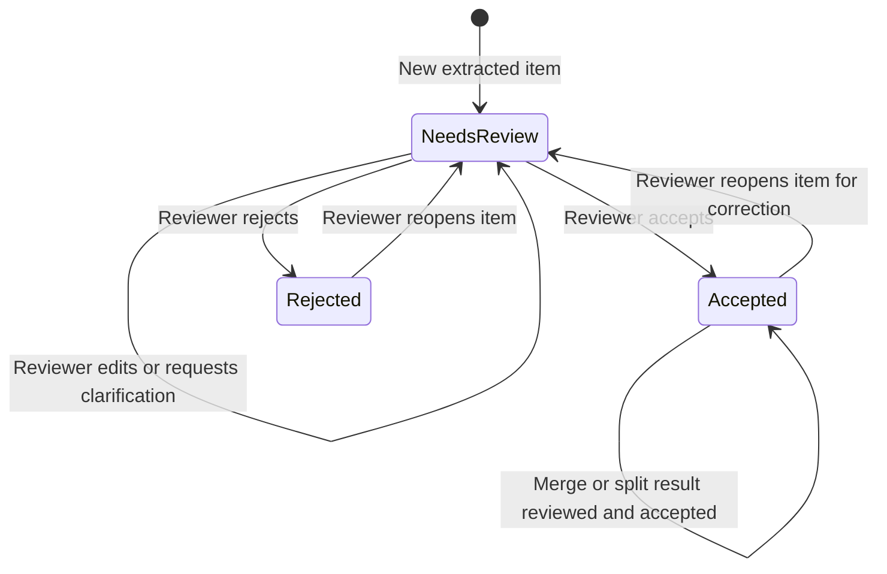

The states above describe **review status**, not the operational status of a task. For an accepted task, the exported tracker status defaults to **Open**. Exported task status values may be Open, In progress, Blocked, or Done; the LLM must not invent these operational statuses from the transcript.

### 7.4 Review summary and export gate

The Review screen keeps a summary bar showing counts for:

- Total tasks.
- Tasks without an owner.
- Tasks without a due date.
- Risks.
- Open questions.

Before export, every item must have an explicit review decision: **Accepted** or **Rejected**. The UI may provide **Accept all non-low confidence**, but low-confidence items must not be automatically accepted. The exact treatment of rejected items in each export format should follow the export contract; the Excel task tracker includes accepted tasks.

## 8. Flow 4 — Clarify missing or uncertain information

The Clarify screen collects gaps across extracted items so the reviewer can follow up without searching through the whole transcript.

### 8.1 Entry conditions

An item appears in Clarify when relevant fields need confirmation, for example:

- Task owner is not stated.
- Deadline is not stated or is vague.
- An owner is only implied or multiple people may be responsible.
- A risk has no supported owner.
- An open question has no clear person responsible for answering it.
- A relative date cannot be resolved because the meeting date is unknown.

### 8.2 Clarification flow

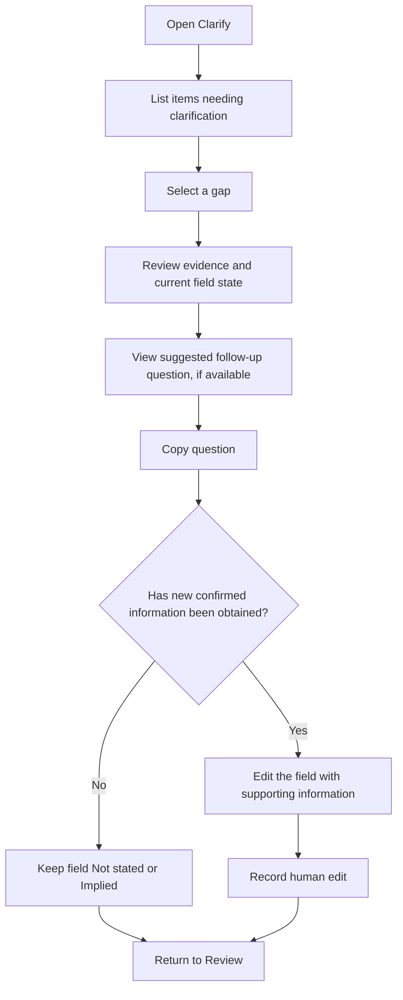

The application can suggest a follow-up question, such as “Who will own the data export check?” The suggestion is not evidence and must not automatically populate the owner or date. Unless the reviewer supplies and confirms supporting information, unknown fields remain unknown.

## 9. Flow 5 — Resolve possible duplicates

Duplicate detection compares each new task with earlier tasks for the same client. It uses TF-IDF word 1–2 grams and cosine similarity in v1.0.

### 9.1 Similarity bands

| Similarity score | Label | Application behaviour |
|---|---|---|
| 0.80 or higher | Likely duplicate | Show the pair for reviewer decision |
| 0.60–0.79 | Possibly related | Show the pair for reviewer decision |
| Below 0.60 | No duplicate flag by default | Do not show in the default duplicate list |

The threshold is configurable. Matching owner and due date may increase the similarity signal according to the implemented scoring rules.

### 9.2 Reviewer decision flow

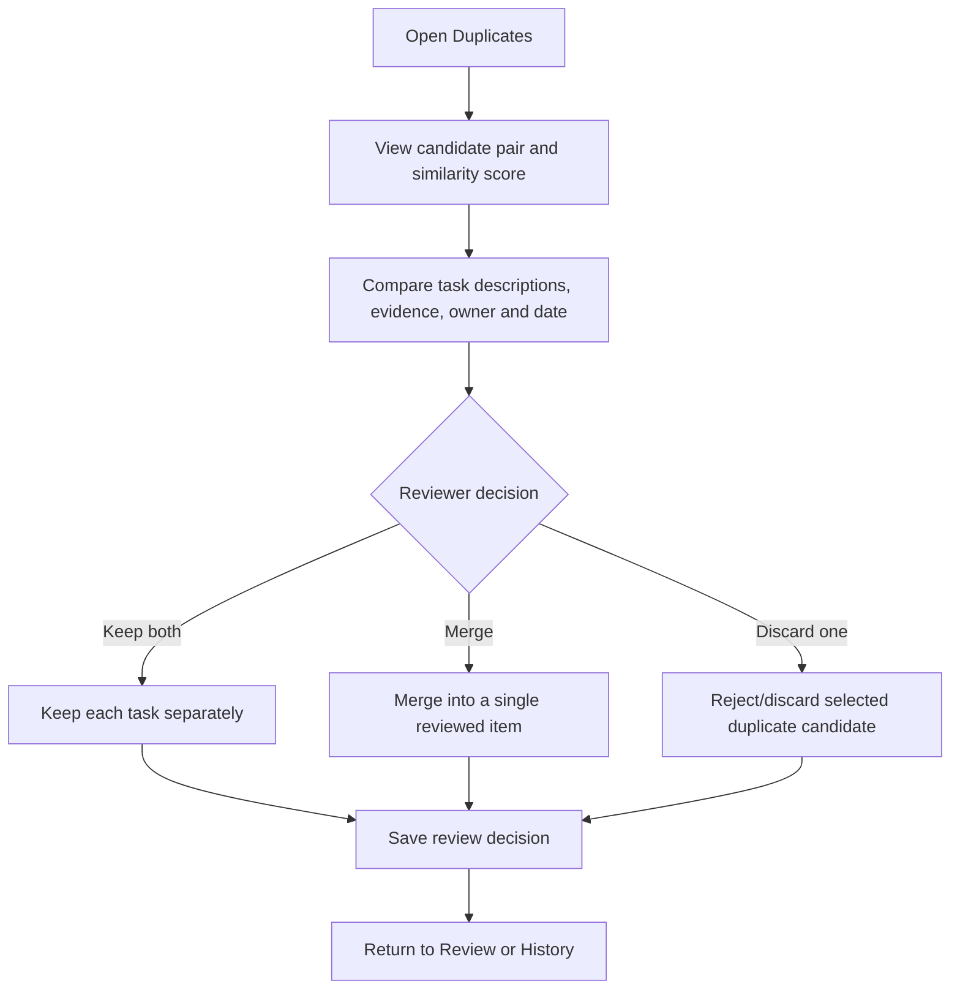

No candidate is removed automatically. The PRD uses “discard” in the duplicate screen and “reject” in the review workflow; implementation should retain an auditable review decision rather than physically deleting an item without a documented rule.

## 10. Flow 6 — Export reviewed results

The Export screen is available after the review decisions are complete. The user chooses the output format, optionally chooses a column mapping, previews the content, and downloads the generated file.

### 10.1 Supported output formats

| Format | Output | Main content |
|---|---|---|
| Excel | `.xlsx` | Tasks sheet, Decisions, Risks, Open Questions, and README sheets |
| CSV | `.csv` | Tracker-ready rows using the selected column mapping |
| Word | `.docx` | Meeting details, summary, decisions, action items, risks, open questions, and review footer |
| JSON | `.json` | Full structured result; P1 in the PRD, intended for v1.0 if included in the release scope |

The PRD's v1.0 scope lists JSON export as P1, while the primary export and acceptance requirements emphasize Excel, CSV, and Word. If the release needs to be reduced, JSON is the first export feature that can be deferred.

### 10.2 Export flow

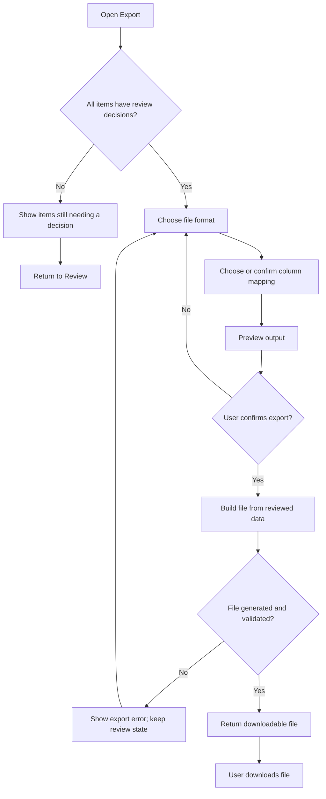

### 10.3 Export safeguards

- Only accepted tasks are included in the accepted-task Excel tracker.
- The export must preserve the distinction between Stated, Implied, and Not stated.
- If an owner is not stated, the Owner cell displays **Not stated**; structured values remain null.
- An unresolved due date remains blank in the resolved-date column, while the original wording is preserved in the raw-date column when available.
- Unknown values are never replaced by a guessed name, date, priority, or status.
- CSV column names and order follow the selected mapping. Default mappings are planned for Jira-style and Asana-style imports, but v1.0 performs file export only; it does not push data into those services.
- Export failures must not undo review edits or require the user to repeat the review.

### 10.4 Word meeting minutes layout

The generated meeting minutes contain:

1. Title block: client, meeting title, date, and attendees.
2. Meeting summary.
3. Numbered decisions.
4. Action-item table: task, owner, and due date.
5. Risks table: risk, impact, mitigation, and owner.
6. Open questions and who should answer them, if stated.
7. Footer identifying that the minutes were generated from meeting notes and reviewed by the reviewer, with the generation date.

## 11. Flow 7 — History and returning to a saved meeting

The History screen lets the user find prior meetings and inspect open tasks, risks, and questions for a client.

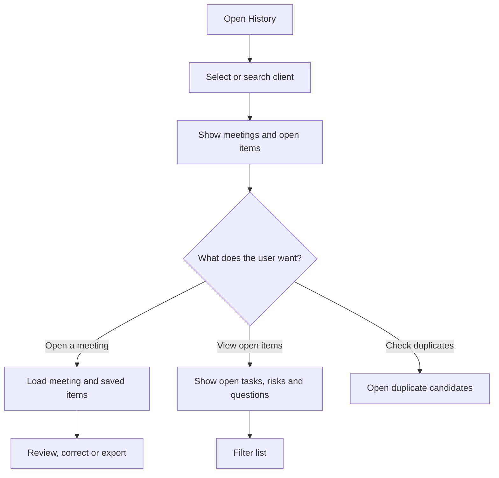

Meeting content, extracted items, review decisions, and run metadata are stored in SQLite. History should show the client, meeting title/date, and current item/review information. Listing past meetings and open items per client is P1 in the PRD, while local persistence of meetings, items, and review decisions is P0.

A configurable retention policy is planned with a default of 90 days. A **Delete meeting** action must remove the stored transcript, associated items and review history, and related stored exports as applicable. The exact treatment of backups and generated downloads outside the application is an operational policy to confirm before launch.

## 12. Flow 8 — Settings and administration

The Settings screen contains technical configuration that can be changed without modifying application code where the PRD requires it.

### 12.1 Settings fields

- LLM provider and model.
- Provider API key, supplied through environment variables or a secret store rather than an editable plaintext field in the UI.
- Duplicate similarity threshold.
- Relative date interpretation convention, including the rule for “next Friday.”
- CSV/Excel column mappings.
- Token/cost warning threshold where configured.

### 12.2 Settings flow

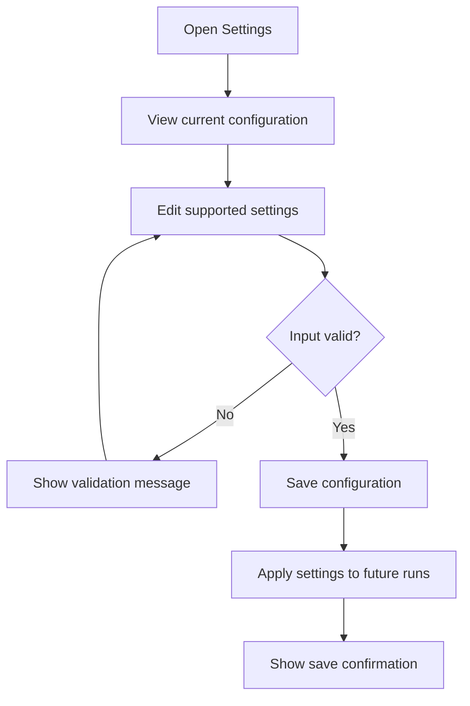

API keys must remain outside version control and must never appear in UI logs or normal application logs. The specific provider/model approval, allowed transcript data handling, and credentials deployment method must be confirmed by the team before production use.

## 13. Date and uncertainty decision flow

The application must distinguish between what the meeting explicitly states, what it strongly implies, and what is absent.

### 13.1 Owner decision flow

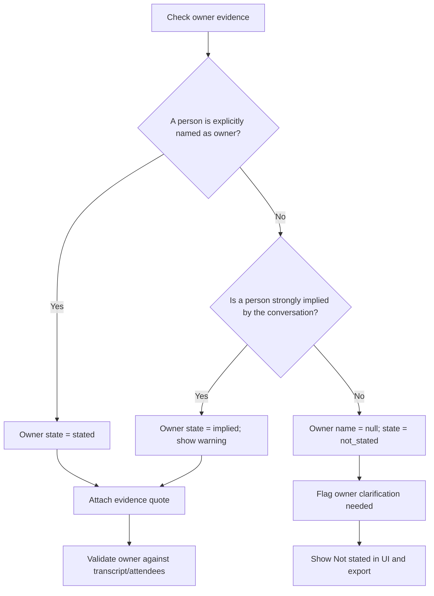

“We,” “the team,” “someone,” and “everyone” must not be transformed into an individual name. If multiple people appear to claim an action, the owner should remain unresolved with a note and clarification flag unless the transcript clearly resolves responsibility.

### 13.2 Due-date decision flow

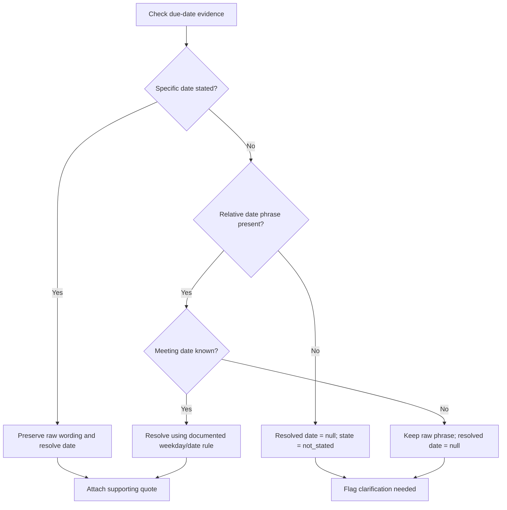

The raw date wording is retained even when a calendar date can be resolved. For example, “next Friday” must be interpreted using the documented team convention, and resolution is not attempted if the meeting date is unknown. The specific “next Friday” rule is listed as an open team decision in the PRD and must be confirmed before release.

### 13.3 Validation guardrails

- A field with state `not_stated` must have a null value, not an empty string, “TBD,” “N/A,” or an invented default.
- Every owner and due date must be supported by an evidence quote; otherwise it is marked not stated.
- Quotes are fuzzy-matched against the original transcript. A match below 85% triggers a low-confidence warning and a “quote not found” flag.
- Owner names are checked against the attendee list or transcript; unmatched names are flagged.
- Resolved dates earlier than the meeting date are flagged unless the transcript explicitly supports them.
- The LLM does not invent priority, status, or dependencies.
- Instructions embedded in the transcript are treated as meeting data, not as system instructions.

## 14. API interaction map

The Streamlit UI talks to the FastAPI backend over HTTP and JSON. The UI does not call the LLM provider directly.

| User action | Backend request | Result used by the UI |
|---|---|---|
| Create meeting | `POST /meetings` | Meeting identifier and saved metadata |
| Run extraction | `POST /meetings/{id}/extract` | Structured meeting result and run identifier |
| Open saved meeting | `GET /meetings/{id}` | Meeting details, current items, review statuses |
| Edit/review an item | `PATCH /items/{id}` | Updated item and review state |
| Merge items | `POST /items/{id}/merge` | Merged item |
| Split an item | `POST /items/{id}/split` | Two resulting items |
| View duplicate candidates | `GET /meetings/{id}/duplicates` | Candidate pairs and similarity scores |
| View client open items | `GET /clients/{id}/open-items` | Tasks, risks, questions, and filters |
| Export file | `POST /meetings/{id}/export` | Downloadable file |
| Check service health | `GET /health` | Service status, model, and version |

Expected API behaviour includes HTTP 422 for invalid request payloads, HTTP 413 for oversized files, and HTTP 502 when the LLM provider fails. Each log line includes a request identifier. Error responses should be clear enough for the UI to explain the problem without exposing sensitive internals.

## 15. Application states and transitions

The application should maintain a distinction between meeting processing state, item review state, and exported task status.

### 15.1 Meeting processing state (proposed implementation detail)

| State | Meaning | Next possible state |
|---|---|---|
| Draft | Meeting input has not passed validation or extraction has not started | Ready, if valid input is saved |
| Ready | Meeting and source text are saved | Processing |
| Processing | Extraction pipeline is running | Review ready, Failed |
| Review ready | Extracted items are saved and ready for human review | Review ready, Exported |
| Failed | Extraction or processing stopped with an error | Processing, if retried |
| Exported | At least one export file was generated successfully | Review ready, Exported |

These meeting-level states are proposed to clarify implementation and are not a separate set of product requirements in the PRD. They must not replace the item-level review state.

### 15.2 Item review state

| State | Meaning |
|---|---|
| Needs review | Newly extracted item or item requiring another decision |
| Accepted | Reviewer approves the item for applicable exports |
| Rejected | Reviewer declines the item for applicable exports |

### 15.3 Operational task status

Operational status is a separate field in the exported tracker: Open, In progress, Blocked, or Done. An accepted task defaults to Open after acceptance/export unless the reviewer explicitly changes it. The extraction model must not infer operational status from unclear language.

## 16. Error, exception, and recovery flows

| Scenario | What the user sees | Application response |
|---|---|---|
| Empty pasted text | Validation message | Do not start extraction; retain form contents |
| File too large or unsupported | File validation message | Reject upload before extraction |
| File is unreadable | Readability error | Let user select another file or paste text |
| LLM timeout or provider outage | Clear extraction failure | Retry with backoff within configured limits; retain source text |
| Invalid LLM JSON | Processing continues during retry, then succeeds or fails clearly | Validate with Pydantic and retry up to two times |
| Quote cannot be found | Evidence warning and low confidence | Flag the item for review; do not treat quote as verified |
| Owner cannot be confirmed | Owner not stated or implied warning | Keep unknown value null; add clarification flag |
| Relative date cannot be resolved | Raw date phrase shown; resolved date remains blank | Require meeting date for resolution; never guess a date |
| Duplicate candidate found | Side-by-side comparison | Ask reviewer to keep, merge, or discard; never auto-delete |
| User attempts export before review decisions are complete | List of unresolved review decisions | Return to Review and prevent final export |
| Export generation fails | Clear export error | Keep all review data and allow retry |
| Delete meeting requested | Confirmation and result message | Remove stored meeting text, associated items, review history, and applicable stored exports per retention policy |

## 17. Privacy, security, and data handling flow

1. The user submits meeting text or a supported file.
2. The application validates the file and stores the source text in the local SQLite database.
3. Only the backend extraction module sends transcript chunks to the approved LLM provider.
4. If enabled, name/email redaction is performed before sending content to the provider.
5. The provider returns structured output; the backend validates and verifies it before saving extracted items.
6. Logs contain request/run identifiers, model, prompt version, latency, token counts, and validation outcome, but not raw transcript text.
7. Stored meeting data follows the configured retention period, with 90 days as the PRD default. The user can delete a meeting and its related application-held data.
8. API keys are supplied through environment variables or a secret store. HTTPS is required for shared deployments.

Before launch, the team must confirm the LLM provider's data-retention and no-training terms and whether client transcripts are permitted to leave the company network.

## 18. Quality and release checkpoints

The main journey is considered ready for v1.0 when the following checkpoints pass:

- A user can create a meeting, paste text or upload a supported file, run extraction, review the items, and export a tracker.
- The flow identifies decisions, tasks, risks, and open questions with evidence quotes.
- Missing owners and due dates remain visibly unknown and do not become invented values.
- Relative dates resolve only when the meeting date is available and the date rule has been agreed.
- Low-confidence items cannot be auto-accepted.
- Duplicate candidates are shown for a human decision and never automatically removed.
- Excel, CSV, and Word outputs open correctly and match the reviewed information; JSON output is included if the P1 feature remains in v1.0 scope.
- The failure paths for invalid files, invalid JSON, provider failure, and export errors have automated test coverage.
- The held-out AI evaluation and release gates in the PRD pass, including zero invented owner/deadline values on the test set.

## 19. Open decisions to confirm

The PRD identifies the following decisions as unresolved. The app flow does not assume answers to them:

- Which tracker column format is the first required default: Excel, Jira-style CSV, Asana-style CSV, or another format?
- Which LLM provider/model is approved for client data?
- May transcripts be sent outside the company network, and under what retention/no-training terms?
- Who is the product owner responsible for final release approval?
- What is the team's convention for interpreting “next Friday”?
- What is the required retention period for meeting data?
- Is JSON export required for v1.0, or can this P1 feature move to a later release?

---

**End of App Flow document.**
